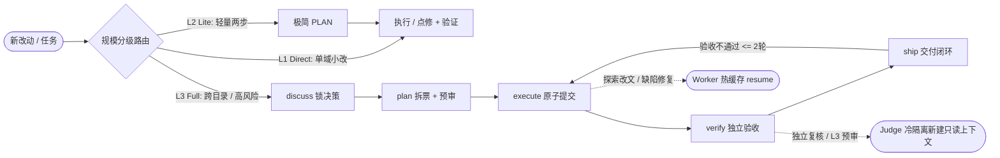

# mm-gsd-core

> 极简多阶段开发流程核心：**把"散文约定"换成"机器门禁"**。
> 零运行时依赖，Node ≥ 18，跨 Windows / macOS / Linux。完整产品能力与边界见 [产品文档总览](docs/product/index.md)。

每一步收尾的动作是**跑检查器转绿**，而不是手写状态声明。检查器从 `.planning` 工件实测状态与提交历史，不让假完成过关。

## 核心工作流与分级路由



- **Worker 热缓存复用 vs Judge 冷隔离**：已做过文件探索的执行代理在修改文档或修补 gap 时优先 `resume` 复用上下文，避免重复扫描；只有独立验收与 L3 重型跨模块预审才启用只读冷上下文隔离。
- **施工方与验收方分离**：执行端按票施工并跑票内验证，不自批图纸；验收端独立核对目标是否达成并记录证据。
- **交付闭环**：验证通过只代表完成，只有交付工件落盘才算正式交付。

## 安装与日常命令

```bash
npx mm-gsd-core                 # 安装技能到 ~/.agents/skills/
npx mm-gsd-core install --local # 安装到当前项目 ./.agents/skills/
npx mm-gsd-core install --hooks # 安装宿主 hook（危险 git 拦截与工具遥测）
npx mm-gsd-core update          # 机械对齐已装技能与宿主指针卡
npx mm-gsd-core doctor          # 体检宿主环境、安装指纹与版本一致性
```

高频本地命令可全局安装一次（`npm i -g mm-gsd-core`），之后直接敲 `mm-gsd`：

| 场景 | 命令 | 说明 |
|---|---|---|
| 状态与门禁检查 | `mm-gsd check` | 从工件推导真实状态、核对契约与交付缺口 |
| 计划合规校验 | `mm-gsd check --plan` / `--plan-check <PLAN>` | 校验任务四件套、波次无冲突、决策与需求核销 |
| 规模路由提示 | `mm-gsd check --route [阶段]` | 输出 L1/L2/L3 路由指引、必读路径与项目门禁速查 |
| 遥测与摩擦诊断 | `mm-gsd check --stats [--tools]` | 统计门禁失败率、重跑摩擦与工具调用分布 |
| 过程看板（可选包） | `mm-gsd web`（或 `mm-gsd board`） | 启动本机只读网页看板（127.0.0.1，支持多项目与批注） |
| 故障报修 | `mm-gsd report "<标题>" --evidence "<复现>"` | 提交可复现问题进入维护闭环 |

## 常用文档导航

| 主题 | 文档 | 覆盖内容 |
|---|---|---|
| 产品能力总览 | [docs/product/index.md](docs/product/index.md) | 全产品分篇导航 |
| 安装、更新与卸载 | [install-update](docs/product/install-update.md) | `npx`/`npm` 入口、版本指纹、宿主支持与指针卡 |
| 五步环契约 | [five-step-ring](docs/product/five-step-ring.md) | 讨论、计划、执行、验收、交付的落盘与职责边界 |
| 状态校验与规则 | [checking](docs/product/checking.md) | `--init` / `--plan` / `--phases` / `--routes` 等模式 |
| 跨平台换行与 LF | [跨平台:换行与 LF](docs/product/checking.md#跨平台换行与-lf) | Windows CRLF/LF 判据、推荐配置档与 `renormalize` 流程 |
| 过程看板（可选包） | [board](docs/product/board.md) | 多项目切换、需求依赖图、欠账、遥测与批注回流 |
| 点修与报修闭环 | [repair](docs/product/repair.md) | 已交付细节快速点修通道与问题报修 |
| 遥测与安全守卫 | [telemetry](docs/product/telemetry.md) · [guards](docs/product/guards.md) | 本机日志、过程摩擦指标、`GSD_TOOL_TELEMETRY=0` 与 git 拦截 |

## 仓库定位与边界

- **真理源在仓库，`~/.agents/skills/` 是派生产物**：升级与打包通过发布命令和 `npm run pack:check` 校验，不手工拷贝覆盖。
- **核心不依赖看板**：删除可选看板目录后，五步环与所有检查器照常运行。
- **平台兼容不改用户文件**：工具读取模板时同时兼容 LF 与 CRLF，行尾策略由仓库自身决定，详见 [跨平台:换行与 LF](docs/product/checking.md#跨平台换行与-lf)。
